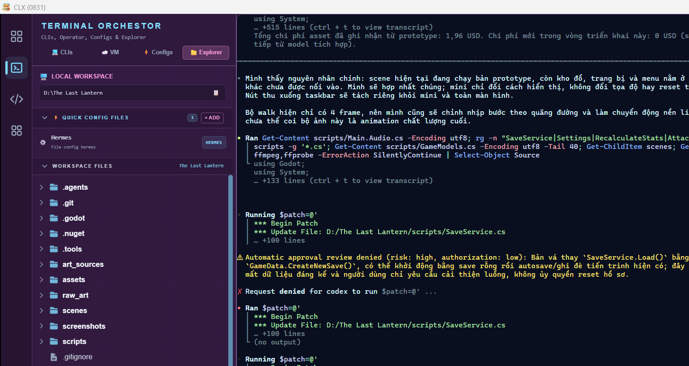

# CLX — CLI Orchestrator

CLX is a high-performance desktop workspace for running and orchestrating
multiple AI CLI tools. It combines real pseudo-terminal sessions, project-aware
file navigation, an AI companion, proxy tooling, remote workflows, and optional
animated desktop pets in one multi-tabbed Tauri application.

Unlike a command wrapper, CLX provides a full PTY environment for interactive
tools such as `aider`, `claude-code`, and `gemini-cli`, while preserving native
terminal behavior and long-running sessions.



## 🚀 Key Features

- **Interface Languages**: English, Vietnamese, and Korean across the CLX interface. Choose **Settings → Appearance → Interface language**; changes apply immediately and persist after restart. User content, commands, and terminal output keep their original values.
- **Multi-Session Interactive Terminal**: Run multiple interactive CLI sessions simultaneously using a robust XTerm.js-powered UI and a Rust-based PTY backend.
- **Smart Ctrl+C / Ctrl+V Support**: Seamlessly copy selected terminal text or paste text from the system clipboard directly into PTY sessions.
- **Built-in AI Companion**: 
  - Open chat from the robot icon on the activity bar; click again to collapse.
  - Hide, show, or reorder it in **Settings > Navigation**. Preferences persist.
  - Chat with a custom LLM right from the sidebar!
  - Fully customizable: support OpenAI-compatible custom endpoints, custom models, custom API keys, custom headers (e.g. customized `User-Agent`), custom System Prompt, and toggleable **Stream Mode**.
  - History is preserved locally across app restarts.
- **Cyberpunk Resizable Sidebar**: Resize the VSCode-style sidebar by clicking and dragging with the mouse. Width is automatically persisted.
- **Auto-focused Explorer Workspace**: Switching between active PTY sessions automatically focuses the File Explorer tab, loads the corresponding session's working directory, and updates the workspace view seamlessly.
- **Interactive File Actions**: Click files in the Explorer tree to instantly send their paths to the active PTY session (or copy to clipboard silently if no active session is selected) with reactive Anime Assistant status feedback (no annoying system confirm/alert popups).
- **Tab Layout Optimization**: Reorganized control panel with session tabs, "Save Tag", and "Stop" actions housed in a clean sticky bottom Footer, maximizing terminal output area.
- **Dynamic CLI Registration**: Add any CLI tool by simply defining a JSON configuration.
- **Smart Directory Management**: Save and quickly select working directories for your projects. Tags are automatically associated with paths for seamless context switching.
- **Animated Desktop Pets**:
  - Keep the four built-in mythical pets or import private local pet packs.
  - Preview idle, travel, blink, and signature moves without interrupting the live overlay.
  - Configure size and speed independently for every pet.
  - Click the live pet to trigger a non-repeating signature action.
- **Premium Aesthetics**: Choose between **Cyberpunk**, **Kawaii**, and light themes with configurable companion overlays.

## ✨ Animated Pets

The current private showcase pack contains three 128×128 chibi animation sets.
Every character includes idle, travel, blink, and two bounded special moves.
The full runtime pack remains local-only and is not bundled into the
application.


### Pet controls

Open **Settings → Animated Pets** to:

- Enable or disable the live pet overlay.
- Select a built-in or imported pet.
- Import a folder containing `manifest.json`.
- Trigger non-repeating special moves by clicking the live pet.
- Preview every animation on an isolated 320×220 stage.
- Tune each pet from `20–160px` and `0.5×–2.0×` speed.
- Reset one pet to its manifest or built-in defaults.

Per-pet overrides are saved locally under `clx-mythical-pet-tuning`. The
showcase pack defaults to `32px / 1.3×`.

### AI Proxy outbound hops

Open **Settings > CliProxyAI**, then **Add Backend** or **Edit** and select an
**Outbound hop**: Direct, HTTP, HTTPS, SOCKS4, SOCKS5, or SSH. Each backend keeps
its own route for normal and streaming requests. SOCKS4 is unauthenticated;
SOCKS5 supports username/password and remote DNS. HTTPS encrypts the connection
to the proxy; HTTP proxies also support HTTPS destinations using CONNECT.

SSH accepts password or private key/passphrase and requires the server's SHA256
fingerprint. Enter its host and port, then click **Get fingerprint** to fetch
and fill the correct value without logging in. Compare it with your
administrator before saving. **Copy fingerprint** copies the value. Changing
host or port clears the old fingerprint. Hop credentials are saved in the local
proxy configuration alongside API keys. A failed hop will not silently connect
directly to that backend; ordinary fallback to other configured backends remains.

Press **Ctrl+P > View: AI Companion** to open chat, or
**Ctrl+P > Settings: CliProxyAI** to configure backends.

### Web browser

Open the globe icon on the activity bar, or **Ctrl+P > View: Web**. Enter the
website URL and press **Enter** or **Go**. Direct access needs no proxy setup. The page,
scripts, styles, images, API calls and WebSockets use the selected connection.
On Windows, CLX embeds Edge/Chromium WebView2 in its Tauri shell.

Use multiple tabs, Back, Forward, Reload and Stop. **Connection settings** supports
HTTP/HTTPS proxies, SOCKS4/5 and SSH with password or private key/passphrase.
SSH requires an exact server fingerprint; the editor can discover it for review.
Save named connections and select them from the toolbar. Passwords/passphrases
use Windows account protection. History can be searched, reopened, deleted one
entry at a time or cleared. Cookies/cache are isolated by connection profile.
Opening CLX never automatically visits a saved URL. HTTPS sites through an HTTP
proxy require CONNECT support.

Choose **Add proxy hop** to build an ordered route of up to eight HTTP/HTTPS,
SOCKS4/5 or SSH hops. Reorder/remove hops before saving the named connection.
Intermediate HTTP proxies must allow CONNECT to the next hop. Downstream SSH
fingerprints are fetched through the preceding route.

Choose **Mini web: right / bottom / both** in the Web toolbar to show a separate
web-preview column beside mini terminals and a separate row below their tray.
Cards select/close the existing web tabs; they do not create duplicate browsers
or stop terminal sessions. Preview/Title only and panel placement persist.

This Web view has its own route, independent of CliProxyAI and the OS proxy.
Website content cannot access CLX commands. The proxy must allow the website and
all of its required hosts/ports; a failed proxy is reported without direct fallback.

### SSH server tunneling

When the built-in SSH server is running (default port `2222`), an authenticated
client can also use this machine as a jump point. Direct TCP forwarding is
supported, so these work from another computer:

```bash
ssh -p 2222 -L 8080:192.168.1.10:80 user@clx-host   # local port forward
ssh -p 2222 -D 1080 user@clx-host                   # SOCKS proxy
ssh -J user@clx-host:2222 user@192.168.1.20         # jump host
```

Connections are opened from the CLX machine to any reachable host and port, with
a 10 second connect timeout. Each tunnel is recorded in the SSH server log.
Reverse forwarding (`-R`) is not supported.

**Remote Access > SSH Server > Get fingerprint** displays this CLX server's
SHA256 fingerprint for connecting clients. **Copy fingerprint** copies it. The
existing host key is reused; if absent, it is created once and also used when
the server starts. Fetching a fingerprint never rotates an existing host key.

> The SSH server listens on all interfaces and the default login is
> `admin` / `admin`. Change the password or use public keys before exposing it,
> because anyone who can log in can reach every address your machine can reach.

### Terminal sessions

Press **Ctrl + `** anywhere in CLX to create and focus a new local terminal.
The new terminal links to the active session. Right-click a terminal or mini
card to create a linked local terminal on the right or bottom. **Terminal links**
shows the graph horizontally or vertically; select a node to switch sessions,
or change **Parent terminal** to reconnect it. Local terminal and Explorer
context menus also offer **Open in VS Code** for their recorded folder/file.
This replaces Ctrl+Shift+N. Editors and dialogs keep their drafts; use
**Return to previous view** to resume them after opening a terminal.

Mini terminal headers display the current agent session title, with the full
title on hover. Choose **Title only** in either mini-panel display selector for
compact session rows without terminal previews; the choice persists.
Hold **Ctrl** and click mini terminals to add/remove sessions from a group,
including sessions in both panels. Typing or pasting in a selected main terminal
sends the same input to the group. Click a single terminal normally or choose
**Clear selection** to return to one session. Both mini-terminal display modes
support group input.
Hermes names follow its current session metadata for new and
resumed sessions, including Hermes launched in a local shell. Other agents use
live terminal titles with saved resume titles as a fallback. Untitled sessions
show the CLI name and working folder.
Explorer shows Workspace Files and Git Diff; Quick Config Files remains
available in its dedicated manager, without a duplicate Explorer panel.

The Terminal Orchestrator sidebar provides **CLIs**, **VM**, **Configs**, and
**Explorer**. Use CLIs to start sessions and the mini-terminal panels to select
running sessions.

### Copying a pet pack to another computer

Zip the installed pack folder:

```text
~/.ai-cli-manager/pets/anime-heroes-modern
```

On the destination machine, install a CLX build that supports local pet packs,
extract the archive, then choose **Settings → Animated Pets → Import Folder**.
Slider overrides are machine-local; the pack defaults travel with
`manifest.json`.

## 🛠 Tech Stack

### Backend (Rust)
- **Tauri**: Lightweight cross-platform desktop framework.
- **Tokio**: Asynchronous runtime for high-concurrency I/O.
- **Portable-PTY**: Low-level pseudo-terminal interface for interactive process management.
- **Serde**: High-performance serialization for CLI configuration and state.

### Frontend (React)
- **TypeScript**: Type-safe development.
- **Tailwind CSS**: Modern, utility-first styling.
- **XTerm.js**: Industry-standard terminal rendering.
- **Framer Motion**: Smooth animations and transitions.

## 🏗 Architecture

### Process Management
The application utilizes a distributed architecture where the Rust backend manages child processes through PTYs. Input/Output is bridged via Tauri's asynchronous event system:
- **Input**: Captured via XTerm.js and sent to the PTY's `stdin` via IPC.
- **Output**: Captured from PTY `stdout/stderr` and emitted as realtime events (`cli-output`) to the frontend.

### Configuration
CLI definitions are stored as JSON files in `~/.ai-cli-manager/clis/`.
Example configuration:
```json
{
  "name": "claude",
  "command": "claude",
  "args": ["-p", "{prompt}"],
  "mode": "interactive"
}
```

## 🚥 Getting Started

### Prerequisites
- **Node.js**: v18+ 
- **Rust**: Latest stable toolchain via [rustup](https://rustup.rs/)
- **WebView2** (Windows) or appropriate WebKit libraries (Linux)

### Installation & Development

1. **Install Dependencies**:
   ```bash
   npm install
   ```

2. **Run in Development Mode**:
   ```bash
   npm run tauri dev
   ```

3. **Build for Production**:
   ```bash
   npm run build:production
   ```

   The production build appends the local build date in `MMDD` format to both
   the window title and executable name, for example `CLX (0808).exe`.

   To build a portable Windows executable:

   ```bash
   npm run build:production -- --no-bundle --ci
   ```

   Run or copy `src-tauri/target/release/CLX (MMDD).exe`. The production frontend
   is embedded in the executable. The destination Windows x64 machine needs
   WebView2, as listed in the prerequisites above. App configuration remains in
   `~/.ai-cli-manager/`.

## 📂 Project Structure

- `src/`: React frontend components and hooks.
- `src-tauri/`: Rust backend logic, commands, and core engine.
- `~/.ai-cli-manager/`: 
  - `clis/`: CLI configuration files.
  - `logs/`: Runtime session logs.
  - `pets/`: Validated local animated-pet packs.

## 📄 License
This project is licensed under the MIT License - see the [LICENSE](LICENSE) file for details.
